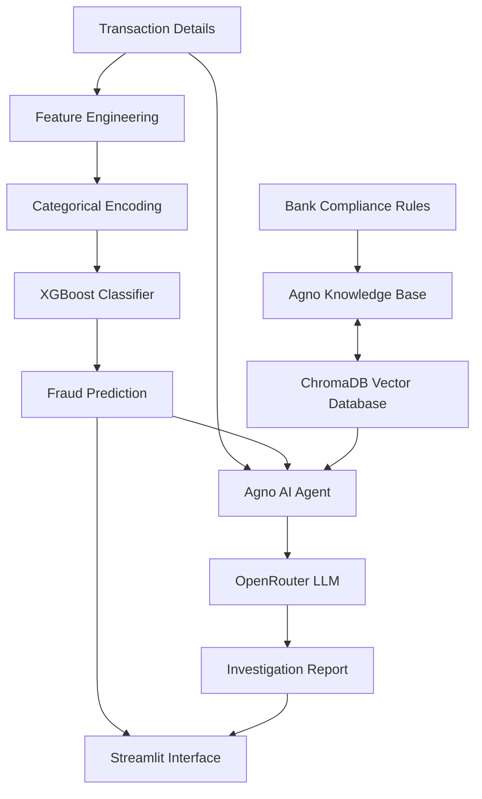

# 🛡️ Trivexa AI — Credit Card Fraud Detection & Investigation

An AI-powered credit card fraud detection system that combines **Machine Learning, Retrieval-Augmented Generation (RAG), and an AI agent** to classify transactions and generate compliance-oriented fraud investigation reports.

🔗 **Live Demo:** [Trivexa AI](https://trivexa-ai.streamlit.app/)  
💻 **GitHub Repository:** [Credit-Card-Fraud-Detection-Model](https://github.com/sanjuktamardi/Credit-Card-Fraud-Detection-Model)

---

## 📌 Overview

Trivexa AI is a machine learning project designed to identify potentially fraudulent credit card transactions and assist with their investigation.

The system uses an **XGBoost classifier** to predict whether a transaction is fraudulent or genuine. It also integrates an **Agno AI agent** with a ChromaDB-backed knowledge base containing banking compliance rules. The agent uses transaction details, the model's prediction, and compliance information to generate a structured investigation report.

The project demonstrates how traditional machine learning can be combined with generative AI and retrieval-based knowledge grounding to support fraud analysis.

## ✨ Features

### 🤖 Machine Learning-Based Fraud Detection
- Uses XGBoost for binary transaction classification.
- Performs feature engineering on transaction timestamps.
- Applies one-hot encoding to categorical transaction features.
- Displays classification metrics and a confusion matrix.

### 🧠 AI-Powered Fraud Investigation
- Integrates an AI agent using the Agno framework.
- Uses an LLM accessed through OpenRouter.
- Generates structured investigation reports from transaction details and model predictions.
- Provides risk indicators, supporting evidence, and recommended mitigation actions.

### 📚 RAG-Based Compliance Knowledge
- Uses ChromaDB as the vector database.
- Loads banking compliance and standard operating procedure (SOP) rules from `bank_compilance_rules.txt`.
- Configures the Agno knowledge base for retrieval.
- Instructs the agent to reference relevant compliance sections and identify missing information.

### 🖥️ Interactive Streamlit Interface
- Accepts transaction details through an interactive form.
- Displays the fraud classification result.
- Presents model evaluation metrics.
- Shows the AI-generated investigation report in the sidebar.

## 🏗️ System Architecture



## 🔄 How It Works

1. **Transaction input:** The user enters transaction information through the Streamlit interface.
2. **Feature engineering:** Timestamp information is transformed into hour, date, month, day-of-week, and night-transaction features.
3. **Categorical preprocessing:** Selected categorical fields are converted into numerical features using one-hot encoding.
4. **Fraud classification:** The XGBoost model predicts whether the transaction is fraudulent or genuine.
5. **Knowledge retrieval:** The Agno agent is configured to search a ChromaDB-backed knowledge base containing banking compliance rules.
6. **AI investigation:** The agent receives the transaction details and model prediction and generates a structured report using the compliance context.
7. **Results display:** The application displays the model prediction, evaluation metrics, and investigation report.

## 🛠️ Tech Stack

| Category | Technologies |
|---|---|
| Programming Language | Python |
| Machine Learning | XGBoost, Scikit-learn |
| Data Processing | Pandas, NumPy |
| Visualization | Matplotlib |
| Web Application | Streamlit |
| AI Agent Framework | Agno |
| Retrieval-Augmented Generation | Agno Knowledge, ChromaDB |
| LLM Integration | OpenRouter |
| Environment Configuration | python-dotenv |

## 📂 Project Structure

```text
Credit-Card-Fraud-Detection-Model/
│
├── model.py
│   └── Data preprocessing, feature engineering,
│       model training, Streamlit UI and predictions
│
├── agent.py
│   └── Agno agent, knowledge-base setup,
│       compliance context and investigation reports
│
├── bank_compilance_rules.txt
│   └── Banking compliance rules and SOP reference
│
├── synthetic_fraud_dataset.csv
│   └── Synthetic transaction dataset
│
├── cleaned_df.csv
│   └── Cleaned or processed dataset artifact
│
├── requirements.txt
│   └── Python dependencies
│
├── .example.env
│   └── Example environment configuration
│
├── .gitignore
│
└── README.md
```

## ⚙️ Installation and Setup

### Prerequisites

- Python 3.10 or a compatible version for the installed dependencies
- Git
- An OpenRouter API key for AI-generated investigation reports

### 1. Clone the Repository

```bash
git clone https://github.com/sanjuktamardi/Credit-Card-Fraud-Detection-Model.git
```

```bash
cd Credit-Card-Fraud-Detection-Model
```

### 2. Create a Virtual Environment

```bash
python -m venv .venv
```

Activate it on Windows PowerShell:

```powershell
.venv\Scripts\Activate.ps1
```

On macOS or Linux:

```bash
source .venv/bin/activate
```

### 3. Install Dependencies

```bash
python -m pip install -r requirements.txt
```

### 4. Configure Environment Variables

Create a `.env` file in the project root and add your OpenRouter API key:

```env
OPENROUTER_API_KEY=your_openrouter_api_key
```

Replace the placeholder with your own API key. Never commit `.env` or expose your API key in a public repository.

### 5. Run the Application

```bash
streamlit run model.py
```

Open the local URL displayed in your terminal, usually:

```text
http://localhost:8501
```

**Note:** The current application reads `synthetic_fraud_dataset.csv` from the project directory. Ensure that the dataset is available before launching the application.

## 📊 Model Evaluation

The application reports the following classification metrics:

- **Accuracy:** Overall proportion of correctly classified transactions.
- **Precision:** Proportion of transactions predicted as fraudulent that are actually fraudulent.
- **Recall:** Proportion of actual fraudulent transactions correctly identified.
- **F1-score:** Harmonic mean of precision and recall.
- **ROC-AUC:** Measures the model's ability to distinguish between the two classes when calculated using prediction probabilities.
- **Confusion Matrix:** Summarizes true positives, true negatives, false positives, and false negatives.

The current implementation calculates these metrics on a held-out test split. However, the preprocessing and prediction pipeline should be made consistent and the ROC-AUC calculation should use predicted probabilities before treating the reported results as validated performance.

No fixed accuracy score is claimed in this README.

## 🔐 Security and Responsible Use

- Keep API keys and other credentials in environment variables or a secure secrets manager.
- Do not upload real cardholder information or sensitive banking data to this demonstration application.
- Treat AI-generated reports as decision-support content, not authoritative financial or compliance decisions.
- Validate model performance, preprocessing, and retrieval quality before considering any real-world application.

## 🚧 Limitations and Future Improvements

- Correct preprocessing consistency between model training and user-input predictions.
- Improve the evaluation pipeline and document verified results.
- Strengthen retrieval validation and provide traceable references to retrieved compliance rules.
- Add automated tests for preprocessing, classification, and report generation.
- Improve error handling for missing data, API failures, and knowledge-base issues.
- Explore explainability techniques to make model predictions easier to interpret.
- Evaluate the system using suitable real-world data only when it can be obtained and handled lawfully.

## 🎯 Learning Outcomes

This project explores:

- End-to-end machine learning workflows for binary classification.
- Feature engineering and categorical data preprocessing.
- Interactive ML application development with Streamlit.
- AI agent development using Agno.
- Retrieval-based knowledge integration using ChromaDB.
- LLM integration through OpenRouter.
- Combining model predictions with compliance-oriented AI analysis.

## 👩‍💻 Author

**Sanjukta Mardi**

B.Tech in Computer Science | AI/ML Enthusiast

- GitHub: [@sanjuktamardi](https://github.com/sanjuktamardi)
- Project: [Trivexa AI](https://trivexa-ai.streamlit.app/)

---

⭐ If you find this project interesting, consider exploring the repository and sharing feedback.

**Built as an educational project exploring Machine Learning, RAG, and AI agents for fraud investigation.**
