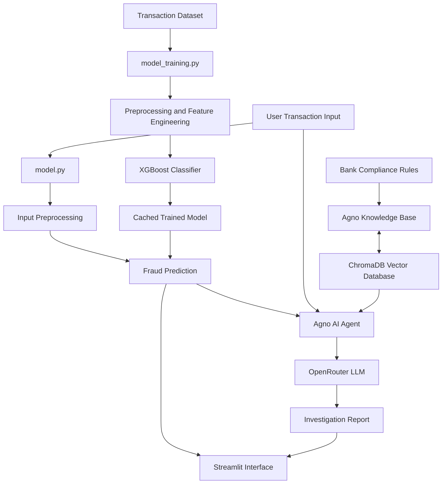

# 🛡️ Trivexa AI — Credit Card Fraud Detection & Investigation

An AI-powered credit card fraud detection system combining **Machine Learning, Retrieval-Augmented Generation (RAG), and AI agents** to classify transactions and generate compliance-oriented fraud investigation reports.

🔗 **Live Demo:** [Trivexa AI](https://trivexa-ai.streamlit.app/)  
💻 **GitHub Repository:** [Credit-Card-Fraud-Detection-Model](https://github.com/sanjuktamardi/Credit-Card-Fraud-Detection-Model)

---

## 📌 Overview

Trivexa AI is a machine learning application designed to identify potentially fraudulent credit card transactions and assist with their investigation.

The system uses an **XGBoost classifier** to predict whether a transaction is fraudulent or genuine. It also integrates an **Agno AI agent** with a ChromaDB-backed knowledge base containing banking compliance rules and Standard Operating Procedures (SOPs).

The AI agent receives transaction information and the model's prediction, retrieves relevant compliance knowledge, and generates a structured investigation report.

The project demonstrates how traditional machine learning can be combined with generative AI and retrieval-based knowledge grounding to support fraud analysis.

## ✨ Features

### 🤖 Machine Learning-Based Fraud Detection
- Uses XGBoost for binary transaction classification.
- Performs feature engineering on transaction timestamps.
- Applies one-hot encoding to categorical transaction features.
- Uses feature scaling for model inputs.
- Displays classification metrics and a confusion matrix.

### 🧠 AI-Powered Fraud Investigation
- Integrates an AI agent using the Agno framework.
- Connects to LLMs through OpenRouter.
- Analyzes transaction details alongside the ML prediction.
- Generates structured investigation reports.
- Provides risk indicators, supporting evidence, and recommended mitigation actions.

### 📚 RAG-Based Compliance Knowledge
- Uses ChromaDB as the vector database.
- Loads banking compliance and SOP rules from `bank_compilance_rules.txt`.
- Uses Agno Knowledge for knowledge-base integration.
- Enables the agent to retrieve relevant compliance information.
- Encourages evidence-based analysis and identification of missing information.

### ⚡ Performance Optimization
- Uses Streamlit caching to avoid unnecessary repeated model initialization and training.
- Separates model training logic into `model_training.py`.
- Keeps the Streamlit interface and transaction interaction logic in `model.py`.
- Separates reusable knowledge-base initialization from transaction-specific report generation.

### 🖥️ Interactive Streamlit Interface
- Accepts transaction details through an interactive form.
- Displays fraud classification results.
- Presents model evaluation metrics.
- Shows the AI-generated investigation report.

## 🏗️ System Architecture



## 🔄 How It Works

1. **Data loading:** The application loads the synthetic transaction dataset.
2. **Preprocessing:** Transaction timestamps are transformed into useful features, including hour, date, month, day of the week, and night-transaction indicators.
3. **Categorical encoding:** Selected categorical features are converted into numerical representations using one-hot encoding.
4. **Model training:** `model_training.py` handles preprocessing, feature scaling, train-test splitting, and XGBoost model training.
5. **Caching:** Streamlit caches the trained model and associated resources to reduce unnecessary repeated initialization.
6. **Transaction prediction:** The user submits transaction details through the Streamlit interface, and the trained model predicts whether the transaction is fraudulent or genuine.
7. **Knowledge retrieval:** The Agno agent uses a ChromaDB-backed knowledge base containing banking compliance rules.
8. **AI investigation:** The agent receives the transaction details and model prediction and generates a structured compliance-oriented report.
9. **Results display:** The Streamlit application presents the prediction, evaluation metrics, and investigation report.

## 🛠️ Tech Stack

| Category | Technologies |
|---|---|
| Programming Language | Python |
| Machine Learning | XGBoost, Scikit-learn |
| Data Processing | Pandas, NumPy |
| Visualization | Matplotlib |
| Web Application | Streamlit |
| AI Agent Framework | Agno |
| Retrieval-Augmented Generation | Agno Knowledge, ChromaDB |
| LLM Integration | OpenRouter |
| Performance Optimization | Streamlit Caching |
| Environment Configuration | Streamlit Secrets / Environment Variables |

## 📂 Project Structure

```text
Credit-Card-Fraud-Detection-Model/
│
├── model.py
│   └── Main Streamlit application, user inputs,
│       transaction predictions, metrics and UI
│
├── model_training.py
│   └── Dataset loading, preprocessing, feature engineering,
│       encoding, scaling, XGBoost training and caching
│
├── agent.py
│   └── Agno AI agent, knowledge-base initialization,
│       compliance context and investigation report generation
│
├── bank_compilance_rules.txt
│   └── Banking compliance rules and SOP reference
│
├── synthetic_fraud_dataset.csv
│   └── Synthetic credit card transaction dataset
│
├── cleaned_df.csv
│   └── Cleaned or processed dataset artifact (if retained)
│
├── requirements.txt
│   └── Python project dependencies
│
├── .example.env
│   └── Example environment configuration (if used)
│
├── .gitignore
│   └── Excludes sensitive files, virtual environments
│       and generated runtime artifacts
│
└── README.md
    └── Project documentation
```

**Runtime-generated resources:**

```text
tmp/
└── chromadb/
    └── Persistent ChromaDB vector database files
```

The ChromaDB directory is generated or populated when the knowledge base is initialized. It does not need to be committed as part of the source code.

## ⚙️ Installation and Setup

### Prerequisites

- Python 3.10 or a compatible version for the installed dependencies
- Git
- An OpenRouter API key for AI-generated investigation reports

### 1. Clone the Repository

```bash
git clone https://github.com/sanjuktamardi/Credit-Card-Fraud-Detection-Model.git
```

```bash
cd Credit-Card-Fraud-Detection-Model
```

### 2. Create a Virtual Environment

```bash
python -m v